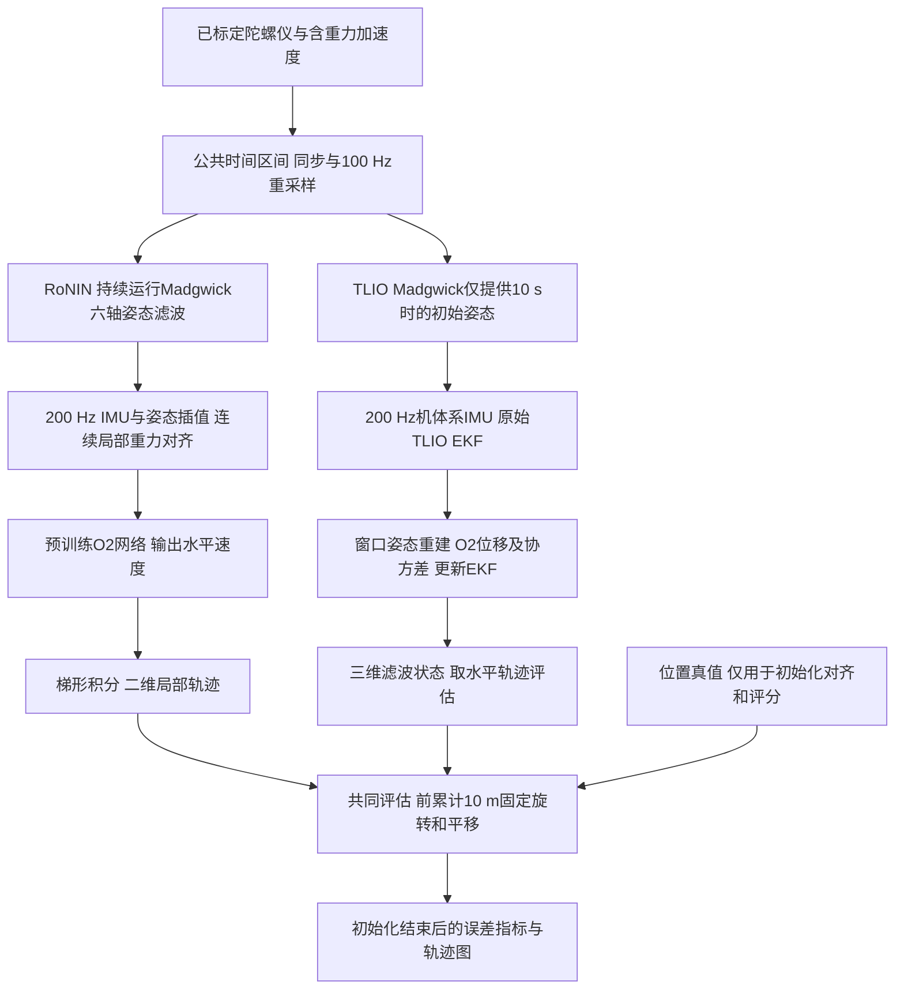

# PedROAM 惯性里程计 Baseline 使用指南

本文说明当前 **EqNIO-RoNIN O2** 和 **EqNIO-TLIO O2 + EKF** 的处理流程、输入输出，以及可以自行执行的实验命令。两者均使用发布的预训练权重，不在 PedROAM 上训练或微调，用于数据集论文的 Evaluation。

## 统一入口：指定数据与结果目录

激活 `eqnio` 后，只需要指定数据根目录和一个**尚不存在**的结果目录：

```bash
conda activate eqnio
python -B scripts/run_baselines.py \
  --data-root /home/maxson/data/PedROAM \
  --out-root /home/maxson/code/pdr-test/EqNIO/outputs/my-baseline-run
```

默认对所有匹配记录运行两条 baseline，执行顺序为：推理、共享真值检查、
各模型的连续累计 10 m 初始化评估，最后汇总指标。默认不训练或微调。
`--data-root` 必须包含 `recordings/`，输入目录结构与 CSV 格式见第 2 节；
不直接接受单个 `sensorlogger/` 文件夹。相对路径按启动命令时所在目录解析，
也支持绝对路径和带空格的路径（命令行中需加引号）。

仅运行 TLIO 的某一条完整记录：

```bash
python -B scripts/run_baselines.py \
  --data-root /home/maxson/data/PedROAM \
  --out-root outputs/my-tlio-run \
  --model tlio --session 0422-AM1-2026 --person P02 --workers 1
```

快速验证时，可加 `--max-seconds 180`；只使用 CPU 时加 `--cpu`。
截取时长必须留出姿态预热、有效真值区间和初始化后评分时间，
否则程序会报错，而不是输出没有完成初始化的指标。

| 参数 | 含义 |
| --- | --- |
| `--data-root` | 必填，包含 `recordings/` 的数据目录 |
| `--out-root` | 必填，新结果目录，必须位于输入数据和权重目录之外 |
| `--model ronin\|tlio\|both` | 运行方法，默认 `both` |
| `--session`、`--person` | 可选记录筛选；省略时处理所有匹配记录 |
| `--checkpoint-root` | 权重总目录，包含 `Ronin_o2/`、`TLIO_o2/` 中所选模型的子目录；默认使用本机已有权重 |
| `--max-seconds` | 可选，每条记录仅处理开头指定秒数 |
| `--workers` | TLIO 并行进程数，默认 4；不影响 RoNIN |
| `--cpu` | 使用 CPU；没有可用 CUDA 时必须指定 |
| `--dry-run` | 检查文件路径并打印命令，不推理、不创建结果目录；不验证权重内容 |

输出结构如下；单模型运行只创建对应模型目录。汇总支持任意数量的记录：

```text
my-baseline-run/
├── run.json                         # 参数、选中记录、各阶段命令与完成/失败状态
├── summary.csv                      # 各 baseline 的初始化后汇总指标
├── per_sequence.csv                 # 各 baseline 的逐记录指标
├── logs/                            # 推理、真值检查、对齐各阶段日志
├── reference-audit/                 # 共享真值跳变/缺口检查、初始段图
├── ronin/
│   ├── inference/                   # 原始局部轨迹与推理元数据
│   └── alignment-10m-continuous/     # 对齐轨迹、误差、逐记录图
└── tlio/
    ├── inference/
    └── alignment-10m-continuous/
```

统一入口沿用当前修复方案：间隔 >1.5 s 或速度 >3 m/s 时重置，
等待 10 s 后重新锚定并累计 10 m；预测/真值净位移至少 0.5 m。
详细原理见第 3 节。论文主指标读取顶层 `summary.csv`，不要使用
`inference/summary.csv` 中整段事后最佳对齐的诊断指标。
`initial_post_relative60_rmse_m` 在短记录没有有效配对时可能为空。

运行失败会返回非零退出码，保留已完成阶段和日志，顶层 `run.json`
标为 `failed`。不会把部分记录的结果汇总为一次成功实验，也不会自动覆盖
或续跑已有目录。完整英文论文报告仍使用第 5 节的专用对比脚本生成。

## 1 先运行一个完整样例

本机已配置 `eqnio` 环境。以下命令在仓库根目录执行：

```bash
cd /home/maxson/code/pdr-test/EqNIO
conda activate eqnio
bash scripts/run_baseline_example.sh both
```

该样例处理 `0423-PM-2026/P02` 的前 **180 s**，依次完成两条 baseline 的推理和前累计 **10 m** 初始化评估，最后打印指标及输出目录。选择 180 s 是为了在该记录的初始化结束后保留足够的 60 s 相对位移评估区间。

每次自动生成新的 `outputs/baseline-example-时间-进程号/`，不会覆盖已有实验。也可以只跑一种方法，或指定尚不存在的输出目录：

```bash
bash scripts/run_baseline_example.sh ronin
bash scripts/run_baseline_example.sh tlio outputs/my-tlio-example
```

如果当前终端不方便激活 Conda，可指定本机解释器：

```bash
PYTHON_BIN=/home/maxson/.conda/envs/eqnio/bin/python \
  bash scripts/run_baseline_example.sh both
```

只使用 CPU：

```bash
CPU=1 bash scripts/run_baseline_example.sh both
```

样例脚本还接受 `DATA_ROOT` 和 `CHECKPOINT_ROOT` 环境变量，分别指定数据根目录和**包含两个模型子目录的权重总目录**。它使用当前 Python 环境，不自动创建环境或安装依赖。若已有环境缺少额外依赖，执行：

```bash
python -m pip install -r scripts/requirements-inference.txt
```

新机器的环境配置见根目录 `environment.yml` 和 README；该文件含历史平台及版本约束，本指南的样例以本机已验证的环境为准。

本次已实际运行并保存了 [180 s 样例结果](../outputs/baseline-example-verified/)。该短样例的初始化后位置 RMSE / 60 s 相对位移 RMSE 分别约为：RoNIN **3.13 / 2.64 m**，TLIO **12.02 / 8.65 m**。这些数值只用于核对样例，不是完整数据集指标；不同计算设备可能有小幅浮点差异。成功时，两侧 `inference/failures.json` 均为 `[]`。现有 `baseline-example-verified` 目录不要作为重跑的输出目录。

## 2 输入数据和模型文件

### 数据目录

默认数据根目录是 `/home/maxson/data/PedROAM`。`--data-root` 应指向这一层，不是 `recordings` 或 `sensorlogger`：

```text
PedROAM/
└── recordings/
    └── 0423-PM-2026/                 # --session
        ├── phones/
        │   └── P02/                 # --person，沿用脚本中的记录编号名称
        │       └── sensorlogger/
        │           ├── Gyroscope.csv
        │           └── TotalAcceleration.csv
        └── reference/
            └── P02/
                └── trajectory-gt.csv
```

### IMU 输入契约

| 文件 | 必需列 | 单位和含义 |
| --- | --- | --- |
| `Gyroscope.csv` | `time,x,y,z` | 已标定角速度，rad/s |
| `TotalAcceleration.csv` | `time,x,y,z` | 含重力的加速度，m/s² |

- `time` 是整数 Unix epoch **纳秒**时间戳，不是秒或相对时间。
- 每个文件内部时间戳必须严格递增，XYZ 必须是有限值。处理区间内大于 100 ms 的 IMU 缺口会使该记录失败。
- 按列名读取 XYZ，文件实际列顺序可以是 `time,seconds_elapsed,z,y,x`；额外列不参与推理。
- 两个传感器必须使用同一设备轴系和时间基准。脚本不自动识别轴交换、角度制或单位为 g 的加速度。
- 不读取 `GyroscopeUncalibrated.csv`、磁力计或 `Orientation.csv`，也不以线性加速度替代总加速度。

### 位置真值输入契约

| 必需列 | 含义 |
| --- | --- |
| `observation_utc_seconds` | Unix epoch 秒，与 IMU 时间基准一致 |
| `gt_valid` | 可解析为 `true` 的有效性标记，不使用 `1` 代替 |
| `gt_latitude`, `gt_longitude` | 纬度、经度，度 |
| `gt_height` | 高度，m，作为 WGS84 转 ENU 的高度输入 |

只使用标记有效且上述数值有限的行；按时间排序、去除重复时间戳，并取与预测的共同区间。地理位置转换为局部 ENU；其原点是共同区间内第一个有效真值位置。

**当前命令行入口是“推理后自动评估”的一体化脚本，运行成功需要位置真值文件。** 真值在局部轨迹保存后才读取，不进入神经网络或 EKF；当前没有 `--no-gt` 参数。没有真值时，局部推理可能已经保存，但随后的评估会失败。

### 预训练权重

```text
/home/maxson/code/pdr-test/outputs/eqnio-pretrained/
├── Ronin_o2/
│   ├── checkpoint_38.pt
│   └── config.json
└── TLIO_o2/
    ├── checkpoint_best.pt
    └── parameters.json
```

**两个 Python 入口的 `--checkpoint-root` 层级不同：**

| 入口 | 参数应指向 |
| --- | --- |
| `ronin_pedroam_6d.py` | `…/eqnio-pretrained`，脚本自行添加 `Ronin_o2` |
| `tlio_pedroam.py` | `…/eqnio-pretrained/TLIO_o2` |

## 3 算法流程和坐标系

共同原则：仅使用六轴 IMU，先生成局部轨迹，再利用初始位置变化进行一次平面坐标对齐。所有位置单位为 m，速度为 m/s。局部 XY 初始方向任意，不能直接解释为东、北。



### RoNIN 分支

1. 两路 IMU 线性重采样到 100 Hz，运行 Madgwick 六轴滤波，增益 **0.033**。首个加速度样本初始化倾斜，航向任意；不额外扣除陀螺仪零偏。
2. 前 **10 s** 用于姿态预热，之后才开始模型窗口。IMU 线性插值到 200 Hz，四元数用 SLERP 插值；旋转角速度和总加速度到连续的局部重力对齐坐标系，保留重力分量。
3. 冻结 `resnet18_eq_frame_o2` 权重，输入 **200 点、约 1 s** 的窗口，每 **10 点**滑动一次，输出局部 XY 速度，即 **20 Hz**。
4. 将速度时间戳放在窗口中点，用梯形积分生成二维位置。窗口计算和插值需要缓存，不是零延迟输出。

### TLIO 分支

1. 同样完成 100 Hz 同步；仅利用最初 10 s 的 Madgwick 输出初始化 EKF 姿态。位置、速度和残余 IMU 零偏初始化为零，保留原实现首次网络更新时的零位置/零速度重置。
2. **机体系** IMU 插值到 200 Hz 后进入原始 EKF。后续姿态、速度、位置和残余零偏由 EKF 估计，不持续注入 Madgwick 姿态。
3. 使用滤波器历史姿态和窗口内陀螺仪积分，为网络构造局部重力对齐的 200 点窗口。网络使用 `eq_o2_frame_fullCov_2vec_2deep`，每 50 ms 预测三维位移及协方差。
4. 保留学习坐标系的逆旋转、协方差转换和原始 EKF 更新。沿用上游命令行噪声设置、协方差倍率 **10**、Mahalanobis 门限检验和重力常数 **9.81 m/s²**。
5. 保存 **20 Hz** 滤波状态，默认采样范围与 RoNIN 相同。这里的位置来自滤波器，不是将网络位移当作瞬时速度积分。

四元数输出均为 **`w,x,y,z`**，表示设备坐标到局部参考坐标的旋转。传给 SciPy `Rotation.from_quat` 时需重排为 `x,y,z,w`。TLIO 的零偏估计仍以设备轴系表示。

### 共同的前累计 10 m 对齐

设共同时间戳下的局部预测和真值水平位置为 $p_i,g_i$。默认使用 `continuous` 协议：

1. 相邻真值间隔超过 **1.5 s**，或水平位移除以时间超过 **3 m/s**，标记为连续性断点。
2. 遇到断点，清空累计距离；最后一个断点后等待 **10 s**，选择新锚点 $a$。期间再出现断点则重新等待。无断点时仍从 $a=0$ 开始。
3. 在同一连续段内，首次累计到 **10 m** 即结束；区间仅由真值及时间戳决定，两条 baseline 共用。

$$
j=\min\left\{k:\sum_{i=a+1}^{k}\|g_i-g_{i-1}\|_2\ge10\ \mathrm{m}\right\}.
$$

在同一初始区间内，累加位移**向量**得到 $\Delta p=p_j-p_a$、$\Delta g=g_j-g_a$。固定方向偏置与对齐位置为：

$$
\delta=\operatorname{atan2}(\Delta g_y,\Delta g_x)
-\operatorname{atan2}(\Delta p_y,\Delta p_x),\qquad
\widetilde p_i=R(\delta)(p_i-p_a)+g_a.
$$

这里 $R$ 是二维旋转矩阵。**选区间用累计路径长度，求方向用累计位移向量的方向，平移也使用新锚点。** 不按预测误差选段，不拟合尺度，不更新后续方向，也不使用设备真值 yaw。若该区间的预测或真值净位移小于 **0.5 m**，明确报错，不为某个模型另选区间。

变换到 $j$ 时刻才可用；图中更早的点是回溯变换。主指标只计算 $i>j$ 的点。原始真值和初始化后的位置评分样本保持不变，60 s 相对位移配对不能跨越断点。筛查阈值针对当前约 1 Hz 步行数据，不保证发现缓慢漂移，也不修复参考系统坐标重置。详细证据与复现实验见[真值跳变检查及修复](REFERENCE_JUMP_FIX_ZH.md)。使用 `--protocol legacy` 可复现旧规则，输出到新目录。

## 4 手动执行单条记录

所有代码块均从仓库根目录执行，且需要激活 `eqnio`。下面以 **完整的** `0423-PM-2026/P02` 为例；若只想快速检查，在推理命令中增加 `--max-seconds 180`。

### RoNIN 推理和评估

```bash
run_root="outputs/ronin-single-$(date +%Y%m%d-%H%M%S)-$$"
python -B scripts/ronin_pedroam_6d.py \
  --data-root /home/maxson/data/PedROAM \
  --checkpoint-root ../outputs/eqnio-pretrained \
  --session 0423-PM-2026 --person P02 \
  --out-root "$run_root/inference"
python -B scripts/evaluate_initial_alignment.py \
  --result-root "$run_root/inference" \
  --out-root "$run_root/alignment-10m-continuous" \
  --initialization-distance-m 10 --label Madgwick
```

### TLIO 推理和评估

```bash
run_root="outputs/tlio-single-$(date +%Y%m%d-%H%M%S)-$$"
python -B scripts/tlio_pedroam.py \
  --data-root /home/maxson/data/PedROAM \
  --checkpoint-root ../outputs/eqnio-pretrained/TLIO_o2 \
  --session 0423-PM-2026 --person P02 --workers 1 \
  --out-root "$run_root/inference"
python -B scripts/evaluate_initial_alignment.py \
  --result-root "$run_root/inference" \
  --out-root "$run_root/alignment-10m-continuous" \
  --initialization-distance-m 10 --label TLIO-EKF
```

两个推理入口均接受 `--cpu`。`--max-seconds` 从两路 IMU 公共区间的起点截断，包含 10 s 预热时间。`--workers` 仅属于 TLIO，控制并发记录数；默认是 4，单条记录用 1 即可。

## 5 执行完整的 13 条记录和对比报告

不传 `--session`、`--person`、`--max-seconds` 就会处理数据目录下的全部记录。下列命令应在**同一个终端会话**中执行：

```bash
experiment_root="outputs/baseline-full-$(date +%Y%m%d-%H%M%S)-$$"

python -B scripts/ronin_pedroam_6d.py \
  --out-root "$experiment_root/ronin/inference"
python -B scripts/evaluate_initial_alignment.py \
  --result-root "$experiment_root/ronin/inference" \
  --out-root "$experiment_root/ronin/alignment-10m-continuous" --label Madgwick

python -B scripts/tlio_pedroam.py --workers 8 \
  --out-root "$experiment_root/tlio/inference"
python -B scripts/evaluate_initial_alignment.py \
  --result-root "$experiment_root/tlio/inference" \
  --out-root "$experiment_root/tlio/alignment-10m-continuous" --label TLIO-EKF

python -B scripts/summarize_tlio_baseline.py \
  --ronin-root "$experiment_root/ronin" \
  --tlio-root "$experiment_root/tlio"
```

这组命令使用默认数据和权重目录；迁移到其他路径时，给两个推理入口分别增加相应参数。显存或内存不足时降低 TLIO 的 `--workers`，RoNIN 可降低 `--batch-size`（默认 256）。

对比脚本当前要求 **13 条完整记录**、两侧相同的输入/真值哈希、预测时间戳和初始化区间，并要求输出 `report-continuous/` 尚不存在。它不适用于第 1 节的单条短样例；短样例直接查看各自的 `aggregate.csv` 即可。

`summary.csv`、`failures.json` 会随推理更新；全部成功时 `failures.json` 为 `[]`。确认推理命令成功退出后再执行评估。原始数据和权重保持只读；输出目录不得放入数据集目录，已有推理/对齐目录不会被覆盖。

## 6 输出文件和字段说明

将某种方法的运行目录记为 `<run>`，例如样例中的 `…/tlio`：

```text
<run>/
├── inference/
│   ├── run.json                     # 模型、参数、版本与哈希
│   ├── summary.csv                  # 整段事后最佳对齐的诊断指标
│   ├── failures.json
│   └── <session>/<person>/
│       ├── input_quality.json
│       ├── orientation_6d.npz       # 仅 RoNIN，100 Hz 姿态
│       └── <model-subdir>/
│           ├── trajectory_local.csv
│           ├── filter_diagnostics.npz # 仅 TLIO，20 Hz 状态诊断
│           ├── summary.json
│           ├── evaluation.csv       # 整段事后拟合诊断
│           ├── trajectory_aligned_offline.csv
│           └── trajectory.png       # 整段事后拟合图
└── alignment-10m-continuous/
    ├── aggregate.csv                # 论文使用的总体主指标
    ├── per_sequence.csv             # 逐序列主指标与初始化详情
    ├── run.json
    ├── verification.json
    └── <label>/<session>/<person>/
        ├── trajectory_initial_aligned.csv
        ├── evaluation.csv
        ├── summary.json             # 固定旋转和平移、源文件哈希
        └── trajectory.png           # 前 10 m 对齐后的轨迹与误差
```

默认 `<model-subdir>`：

- RoNIN：`eqnio-ronin-o2-madgwick6d-b0.033-nonebias`。
- TLIO：`eqnio-tlio-o2-ekf-madgwick-init`。

默认评估标签是 `Madgwick`；TLIO 命令通过 `--label TLIO-EKF` 设置标签，因此其图位于 `alignment-10m-continuous/TLIO-EKF/…`。

### 轨迹 CSV

| 文件 | 字段 | 解释 |
| --- | --- | --- |
| `trajectory_local.csv` | `timestamp_ns` | 原始 epoch 纳秒，20 Hz |
| 同上 | `local_x_m,local_y_m` | 任意初始方向的局部水平位置 |
| 同上 | `local_vx_mps,local_vy_mps` | RoNIN 网络速度；TLIO 滤波速度 |
| 同上，仅 TLIO | `local_z_m,local_vz_mps` | 局部竖直位置和速度，不计入当前主指标 |
| `trajectory_initial_aligned.csv` | `east_m,north_m` | 固定对齐后的 ENU 平面位置，m |
| 同上 | `velocity_e_mps,velocity_n_mps` | 经同一固定旋转后的速度，m/s |
| 同上 | `initialization_complete` | 是否严格晚于 10 m 初始化结束时刻 |
| 对齐目录下 `evaluation.csv` | `timestamp_ns,elapsed_s` | 有效真值时刻；从首个共同真值样本起算的秒数 |
| 同上 | `gt_e_m,gt_n_m` | 真值 ENU 水平位置 |
| 同上 | `initial_aligned_e_m,initial_aligned_n_m` | 在相同真值时刻插值并对齐的预测位置 |
| 同上 | `horizontal_error_m,post_initialization` | 水平误差范数，以及是否计入主评估 |
| 同上 | `gt_dt_s,gt_step_m,gt_speed_mps` | 到达该样本的真值时间间隔、水平位移及平均速度 |
| 同上 | `gt_gap_flag,gt_speed_flag,gt_discontinuity` | 时间缺口、速度异常及二者合并标记 |
| 同上 | `gt_segment,gt_anchor_ready` | 连续段编号，以及是否已通过断点后的等待期 |

### NPZ 诊断数据

- RoNIN `orientation_6d.npz`：`timestamp_ns`、`quat_wxyz`，为全处理区间的 100 Hz Madgwick 姿态，包含预热阶段。
- TLIO `filter_diagnostics.npz`：`timestamp_ns`、`quat_wxyz`、`gyro_bias`（rad/s）、`accel_bias`（m/s²）、`state_covariance_diagonal`。
- TLIO 协方差对角线按旋转误差、速度、位置、陀螺仪零偏、加速度计零偏排列，每组 3 维；保存的是**方差**，不是标准差。

### 指标如何读取

| `aggregate.csv` 字段 | 含义 |
| --- | --- |
| `sequences` | 实际参与评估的记录数 |
| `mean_initial_post_rmse_m` | 每条记录初始化后的水平位置 RMSE，再对记录等权平均 |
| `median_initial_post_rmse_m` | 上述逐记录位置 RMSE 的中位数 |
| `mean_initial_post_relative60_rmse_m` | 每条记录初始化后的 60 s 相对位移 RMSE，再等权平均 |
| `mean_initial_full_rmse_m` | 包含初始化段，非论文主指标 |
| `mean_offline_full_rmse_m` | 使用整段真值最佳旋转和平移，只有诊断用途 |

位置 RMSE 为 $\sqrt{\operatorname{mean}(\|\widetilde p_i-g_i\|_2^2)}$。60 s 指标比较两个端点间的预测与真值位移，不单独对齐每个片段；端点时间差容差为 0.1 s，不能跨越被标记的连续性断点（旧版超过 2 s 的缺口限制也保留），两个端点都在初始化结束后。

**论文数值读 `alignment-10m-continuous/aggregate.csv`，不要误用 `inference/summary.csv`。** 短序列没有合格的 60 s 配对时，该指标可能为空/NaN，不代表误差为零。

## 7 用 Python 读取样例结果

将第一行路径替换为样例脚本最后打印的输出目录：

```python
from pathlib import Path
import pandas as pd

example = Path("outputs/你的样例目录")
run = example / "tlio"  # 或 "ronin"
label = "TLIO-EKF"      # RoNIN 使用 "Madgwick"
folder = run / "alignment-10m-continuous" / label / "0423-PM-2026" / "P02"

trajectory = pd.read_csv(folder / "trajectory_initial_aligned.csv")
evaluation = pd.read_csv(folder / "evaluation.csv")
post = evaluation[evaluation["post_initialization"]]
print(trajectory[["timestamp_ns", "east_m", "north_m"]].head())
print("Post-init horizontal RMSE (m):", (post["horizontal_error_m"] ** 2).mean() ** 0.5)
print(pd.read_csv(run / "alignment-10m-continuous" / "aggregate.csv"))
```

`trajectory.png` 可直接打开查看。更新后的完整对比报告在 TLIO 的 `report-continuous/` 中，包含英文 Markdown、逐序列及汇总 CSV，以及 `baseline_comparison.png`。原有 `report/`、`alignment-10m/` 为保留的旧协议结果。

## 8 当前结果与常见问题

当前完整实验目录为 `outputs/ronin-current/` 和 `outputs/tlio-current/`，更新结果位于各自的 `alignment-10m-continuous/`。全部 13 条记录的结果如下；短样例只用于验证执行流程，不能与该表直接比较：

| 初始化后指标 | RoNIN O2 | TLIO O2 + EKF |
| --- | ---: | ---: |
| 平均位置 RMSE | 98.06 m | 222.19 m |
| 位置 RMSE 中位数 | 69.32 m | 168.35 m |
| 平均 60 s 相对位移 RMSE | 16.71 m | 25.46 m |

| 现象 | 处理方式 |
| --- | --- |
| `FileExistsError` | 更换新的输出目录；不要直接使用已有 `*-current` 路径重跑 |
| `No matching/selected recordings` | 核对 `--data-root` 的目录层级、场次和记录编号 |
| 找不到 checkpoint/config | 按第 2 节检查两个入口不同的权重路径层级 |
| `gap >100 ms`、非递增时间戳 | 检查输入；修复或按连续片段组织数据后再评估，不跨大缺口强行插值 |
| `Insufficient valid ground-truth overlap` | 检查真值有效标记、时间单位、绝对时间基准，以及截取时长 |
| `No continuous reference interval reaches ...` | 连续真值区间没有足够距离；检查断点及截取时长，不跨缺口强行累计 |
| `Initial direction is undefined` | 初始区间净位移过小；检查轨迹，不自动改选后续区间 |
| 对比脚本拒绝执行 | 确认两侧都是同一组 13 条完整记录、协议参数一致，且目标 `report-continuous/` 不存在 |
| 轨迹看起来方向正确但仍明显漂移 | 固定初始对齐不保证消除姿态、速度或滤波误差；不进行后续真值纠偏 |

`0422-AM1-2026/P02` 和 `P04` 起始约 37 m 跳变已不再计入初始化；新锚点约为第 16 s，约第 40 s 完成累计 10 m（相对首个共同真值样本）。其余 11 条记录的对齐变换完全不变。这仍是有真值辅助的初始坐标对齐，不是完全无外部信息的绝对航向定位。

实现入口：[RoNIN](../scripts/ronin_pedroam_6d.py)、[TLIO](../scripts/tlio_pedroam.py)、[共同对齐评估](../scripts/evaluate_initial_alignment.py)、[对比报告](../scripts/summarize_tlio_baseline.py)、[可执行样例](../scripts/run_baseline_example.sh)。新增适配和共享流程测试可用 `python -B -m unittest discover -s scripts -p 'test_*.py' -v` 执行；上游历史测试的失败及诊断见现有 TLIO 实验的 `validation/`。
